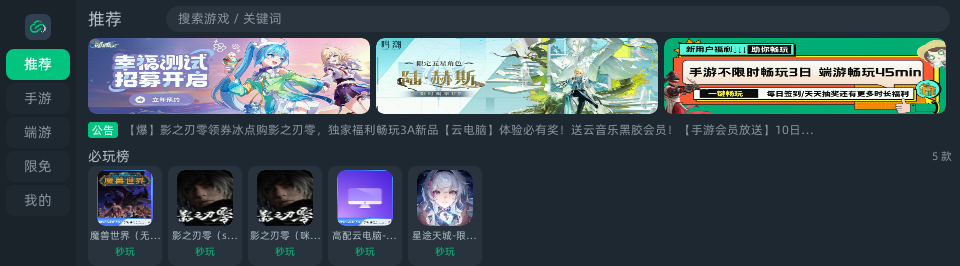
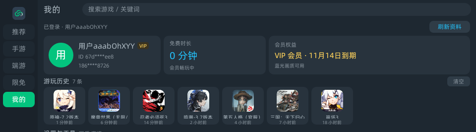
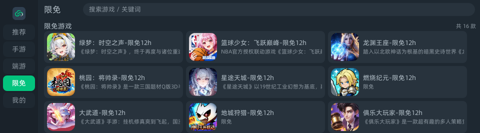
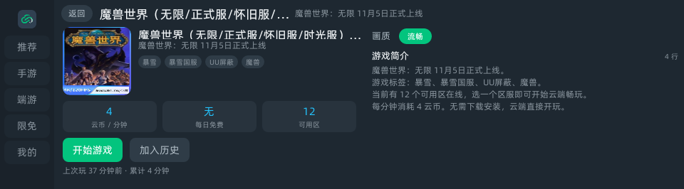
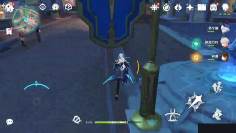
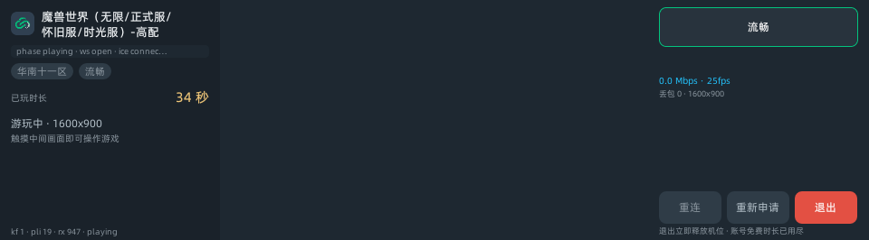
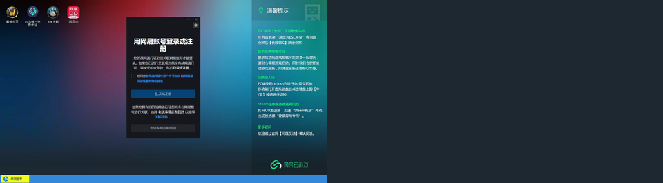
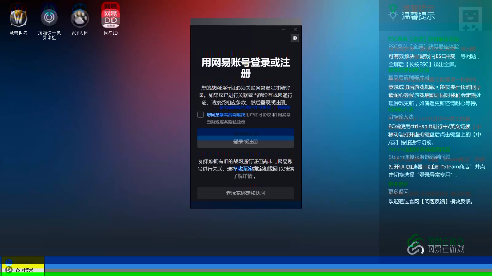

<div align="center">


# PenCG

**网易云游戏（cg.163.com）的有道词典笔 X6 Pro 客户端**

在 960×266 的笔尖屏上，把一整条 WebRTC 协议栈自己写出来。


</div>

---

## 这是什么

PenCG 把[网易云游戏](https://cg.163.com/)搬到了**有道词典笔 X6 Pro**（RK3562 / aarch64 / Buildroot）上。

它不是投屏，不是网页套壳，也不是把 H5 塞进 WebView —— 设备上根本没有浏览器。它是一个**原生云游戏客户端**：

- **界面层**：有道自家的 Falcon 小程序（Vue 2 单文件组件 + QuickJS），画布 960×266
- **网络层**：`libjsapi_cgnative.so` —— 自建 HTTPS 客户端（绕过框架拿不到响应头的限制）+ **手写 RFC6455 WebSocket**（设备上的 libcurl 7.79.1 不带 WS）
- **媒体层**：`libjsapi_cgmedia.so` —— 自写 **ICE + DTLS + SRTP** 全栈，解出 H.264 直接点亮 KMS 硬件视频平面
- **接口层**：直连网易云游戏的 HTTP/WS 接口（逆向笔记见 [docs/CGAPI.md](docs/CGAPI.md)）

> **为什么不直接用 WebRTC？** 设备上**没有** `webrtcbin`、没有 `libsrtp`、没有 `libnice`，
> 只有 GStreamer 1.22 的 RTP 元素和 OpenSSL 1.1.1l。所以 DTLS-SRTP 只能自己实现 ——
> 这大概是这个项目 80% 的工作量。

## 截图

全部在 X6 Pro（960×266）上实拍，位于 [`profiles/evidence/`](profiles/evidence/)。

| 推荐流 | 我的 |
|---|---|
|  |  |

| 限免专区（官方 `tag=限免`，共 16 款） | 详情页（画质单档） |
|---|---|
|  |  |

**云游戏内实拍**（左信息栏 + 中视频 + 右操作栏三栏布局）：

| 原神 · 游戏内 | 蓝牙耳机 · 播放中 |
|---|---|
|  |  |

| 魔兽世界 · 登录界面（还原用户视角） | 出画实证（平面缓冲 1600×900） |
|---|---|
|  |  |

## 功能

| 模块 | 能力 |
| :-- | :-- |
| 首页 | 推荐 / 手游 / 端游 / 限免 / 我的 五栏，横幅、公告、推荐模块横滑、分类网格、分页加载 |
| 详情 | 大图标、简介、标签、云币消耗、每日免费时长、可用区数量、画质选择、一键开玩 |
| 搜索 | 热搜词、本地搜索历史、关键词联想、结果网格 |
| 登录 | 密码登录 / 短信验证码登录，系统输入法（`global.startTextEdit`）优先，自绘键盘兜底 |
| 我的 | 用户头（脱敏 ID + VIP 徽标）、免费时长卡、会员权益、游玩历史、功能入口 |
| **游玩** | 申请机位 → 网关信令 → 视频上屏 → 触摸转发 → 退出释放机位 |
| 云内输入 | 网关下发 `cmd 1` 自动弹输入法、`cmd 5` 回传文字；右栏还有自绘数字键盘 |
| 排队 | 机位紧张时进入排队页，轮询 `status` 直到拿到 `gateway_url` 自动续跳 |
| 自检 | `diag` 页 20+ 项 native 自检（HTTP / 加密原语 / WS 正负用例 / 媒体链路） |

## 快速开始

```powershell
# 1. 构建前端（产出 8002026110200003.1_0_0.amr）
cd PenCG
node ../env/node_modules/aiot-vue-cli/src/cli.js -q -p

# 2. 构建 native 模块
powershell -NoProfile -ExecutionPolicy Bypass -File native/build-net.ps1     # libjsapi_cgnative.so
powershell -NoProfile -ExecutionPolicy Bypass -File native/build-media.ps1   # libjsapi_cgmedia.so

# 3. 装机并截图
powershell -NoProfile -ExecutionPolicy Bypass -File tools/deploy.ps1 -Page index -Shot
```

构建产物 `8002026110200003.1_0_0.amr` 里已经包含 `libs/*.so` 与图标资源。

> ⚠️ 仓库不含 `native/stubs-aarch64*/`、`native/vendor/`、`native/iot-miniapp-sdk/`
> 这三份设备导入库与交叉编译 SDK（约 10 MB），它们来自设备固件 dump 与 Falcon SDK。
> 复现编译前请按 [docs/DEV.md](docs/DEV.md) 自行准备，或直接使用 release 里的 `.amr`。

## 架构

```
┌──────────────────── Falcon 小程序（Vue2 / QuickJS，960×266）────────────────────┐
│ src/pages/index      首页五栏（推荐/手游/端游/限免/我的原地渲染）                 │
│ src/pages/detail     详情 + 画质 + 开始游戏                                       │
│ src/pages/play       播放页三栏（左信息 243 / 中视频 473 / 右操作 244）           │
│ src/pages/queue      排队页                                                       │
│ src/pages/{search,mine,login,diag}                                                │
│ src/components/mine-body.vue   「我的」正文（被 index 与 mine 复用）              │
├───────────────────────────────┬─────────────────────────────────────────────────┤
│ src/services/（纯 JS，14 个模块）                                                │
│   cg.js       网关 HTTP（v1 明文 / v2 偏移异或 + Base64）                        │
│   catalog.js  游戏列表 / 详情 / 限免 tag / webp 图标修复                          │
│   session.js  申请机位、region 探测、ticket 生命周期                              │
│   media.js    WS 信令状态机 → 转发 native                                        │
│   input.js    触摸（视频像素坐标）/ 鼠标（65535 百分比）/ 文本 / 心跳              │
│   im.js       系统输入法封装（global.startTextEdit）                              │
└───────────────────────────────┴─────────────────────────────────────────────────┘
        │ import('cgnative')                      │ import('cgmedia')
┌───────▼────────────────────┐   ┌───────────────▼────────────────────────────────┐
│ libjsapi_cgnative.so       │   │ libjsapi_cgmedia.so                            │
│  HTTPS（libcurl + 裸 body）│   │  ICE（STUN Binding / 487 角色切换）             │
│  SHA256/MD5/3DES/HMAC-SHA1 │   │  DTLS 1.2（OpenSSL，ECDHE-RSA-CHACHA20）        │
│  RFC6455 WebSocket（自写） │   │  SRTP AES128_CM_SHA1_80（自写，ROC 回绕）       │
│  webp → png（ffmpeg）      │   │  RTP 拆包 → H.264 成帧 → mppvideodec → kmssink │
└────────────────────────────┘   │  Opus → opusdec → fdsink → aplay（扬声器/蓝牙） │
                                 └────────────────────────────────────────────────┘
```

详细分层、每个模块的导出契约见 [docs/ARCH.md](docs/ARCH.md)。

## 技术要点

### 游玩链路

```
applyTicket()  →  gateway_url (wss://gw-*.cg.163.com:6443/ws)
      ↓
wsOpen()  →  明文 auth（只发 7 个字段，多一个就 1506）
      ↓
服务端 op=offer（SDP：audio + video + datachannel，BUNDLE，ice-lite，仅一条 host candidate）
      ↓
cgmedia.start(cfg)  →  UDP socket
      ↓
STUN Binding Request（USERNAME / PRIORITY / ICE-CONTROLLING / USE-CANDIDATE /
                      MESSAGE-INTEGRITY / FINGERPRINT）
      ↓
收到 0x0101  →  立刻发 DTLS ClientHello（actpass，我们做 active 方）
      ↓
SSL_export_keying_material("EXTRACTOR-dtls_srtp", 60)
      ↓  client_write_key=km[0..15]   server_write_key=km[16..31]
      ↓  client_salt=km[32..45]       server_salt=km[46..59]
SRTP AES128_CM_SHA1_80 解密（ROC 必须随 seq 回绕递增，不能恒 0）
      ↓
H.264 NAL  →  appsrc ! h264parse ! mppvideodec rotation=270 ! kmssink（KMS 平面）
Opus 帧    →  appsrc ! opusdec ! fdsink → aplay（扬声器 / bluealsa）
      ↓
回 answer（按 offer 的 m-line 数量与顺序动态构造，全部 recvonly + setup:active）
```

### 网关接口

- `api/v1/*` 明文匿名；`api/v2/*` 需要 `Authorization: Bearer`，且**请求与响应体都要做偏移异或 + Base64**
- 偏移量从登录响应的 `encrypt` 字段推导，**HTTP 与 WS 共用同一个偏移**，且**每次登录都不同**（实测已见 6 个不同值）
- 密码登录：`user-pwd-info` 取盐 → `SHA256(salt + pwd)` → 3DES-CBC 加密 → `user-pwd-tokens`

### 这个项目踩过、也值得你避开的坑

完整的坑表在 [docs/MEDIA.md](docs/MEDIA.md) 与 [docs/PLATFORM.md](docs/PLATFORM.md)，这里挑几个最有代表性的：

| 坑 | 现象 | 根因 |
| :-- | :-- | :-- |
| `SSL_export_keying_material` 的 label 长度写成 21 | DTLS 握手完美成功，但**每个 SRTP 包 HMAC 全挂** | `strlen("EXTRACTOR-dtls_srtp")` 是 **19**。这个长度直接进 TLS1.2 PRF 的 seed，差 2 字节 → 导出的密钥完全不同。藏得深是因为自检服务端也写了 21，**对称的错误永远暴露不出来** |
| `SSL_OP_NO_QUERY_MTU` 之后没调 `SSL_set_mtu` | ClientHello **一个字节都发不出去** | `dtls1_query_mtu()` 返回 0 → 第一条记录就 `SSL_ERROR_SYSCALL` |
| STUN keepalive 污染 DTLS 记录层 | 记录头回调 14 次、握手报文回调 0 次 | 网关每 1~2 秒发 STUN，首字节 `0x00` 被当成非法 `rr->type` 静默丢弃。解法：`MSG_PEEK` 分类，STUN 当场应答，DTLS 记录留给 OpenSSL |
| KMS 视频平面退出后不消失 | 游戏退了、软件退了，最后一帧还盖在系统 UI 上 | `GST_STATE_NULL_` 常量写成 **0**，而 GStreamer 枚举是 `VOID_PENDING=0, NULL=1, …`，传 0 等于传非法目标态，`set_state` 直接失败 |
| 画面顺时针转 90° 且拉伸 | 整幅画面贴在面板最右侧 | 两个独立 bug 叠加：`apply_rect()` 面板 y 起点应为 `960-(x+w)` 而非 `rect_y`；且 KMS 平面 **没有** rotate-90/270 属性，旋转必须在解码器里做（`mppvideodec rotation=270`） |
| `appsrc` caps 只写 `audio/x-opus` | 音频包在到、PCM 却停在 `state: OPEN`、`hw_ptr=0` | opusdec 的 sink 有**两支**模板，只给裸 caps 会同时命中 → `GST_FLOW_NOT_NEGOTIATED`，而 `appsrc push` **照样返回 OK**。必须写全 `audio/x-opus,rate=48000,channels=2,channel-mapping-family=0` |
| 进程内 `alsasink` 必败 | 同一条 pipeline 在 adb shell 里完美，在 miniapp 进程里报 `wrong format` | 换 PenBili / PenDouyu 验证过的方案：`fdsink fd=<pipe>` + 外部 `/bin/aplay` |
| 触摸怎么点都没反应 | 画面在播，点屏幕毫无反应 | **自己引入的 bug**：清理临时日志时把 `onTS` 里的 `var ts = (e && e.changedTouches) \|\| [];` 连带删了 → 每次 `touchstart` 抛 ReferenceError。JS 异常只进日志、不阻断画面，所以看起来完全像"协议不对" |
| 对局中途被强拆 | `JS heartbeat lost (18446744073709551615 ms)` | 看门狗里 `now - s->last_poll_ms` 是**无符号**的，JS 线程刚写完更大的值就下溢成 2^64-1。`volatile` 防不住这种语义竞态 |
| 移动端触摸坐标单位 | 发什么都落在右下角 | 官方 `send_message` 走的是**视频像素**（`posX * scaleX`），`65535` 百分比只用于 PC 鼠标协议 `send_message_pc` |

### Falcon / Weex 方言铁律

- **每个 `.vue` 必须** `<style lang="less" scoped>` + `@import "base.less"`，否则黑屏
- **`flex: 1` 简写无效**：必须写 `flex-grow` / `flex-shrink` / `flex-basis` 三连
- **`<text>` 不能换行，中文不会自动裁切**：长名字必须 JS 侧硬截断 + 外层定宽 `overflow: hidden`
- **只支持单类名选择器**：`.a .b` / `.a.b` 会让构建直接失败
- **`<style scoped>` 实际是全局合并**：跨页撞类名会互相污染，必须加页前缀
- **Weex 默认 `flex-direction: column`**：不显式写 `row` 时 `justify-content` 管的是纵向
- **不能把文案写成 method**：`{{ countText }}` 指向 `methods.countText` 时真机会把**函数源码**渲染出来
- **`<input>` 不存在**：文本输入只能走 `global.startTextEdit`，或用自绘键盘
- **`console.log` 不落盘**：只有 `console.warn` / `console.error` 进 `/userdata/applog/`
- **`miniapp_cli capture` 在背光关闭时返回 `ret:0` 但只有 1086 字节纯白**：截前先 `hal-screen on`

## 文档

| 文件 | 内容 |
| :-- | :-- |
| [docs/ARCH.md](docs/ARCH.md) | 分层架构、页面职责、services 全部导出契约、native 模块 API |
| [docs/CGAPI.md](docs/CGAPI.md) | 网易云游戏接口逆向笔记（登录、加密、机位、WS 信令、SDP） |
| [docs/MEDIA.md](docs/MEDIA.md) | 媒体层实现细节与 native 契约 |
| [docs/MEDIA_DEBUG.md](docs/MEDIA_DEBUG.md) | 媒体层攻坚纪实：每个真 bug 的现象、根因与判据 |
| [docs/QUEUE.md](docs/QUEUE.md) | 排队协议逆向（加密帧、`queue_status` 真字段、`queue_success`） |
| [docs/STATES.md](docs/STATES.md) | 页面状态机与 7 条待决策 |
| [docs/PLATFORM.md](docs/PLATFORM.md) | X6 Pro 设备参数、Vue 方言铁律、布局算式 |
| [docs/DEV.md](docs/DEV.md) | 构建 / 部署 / 看日志 / 截图 / adb 路径坑 |
| [HANDOFF.md](HANDOFF.md) | 交接说明：当前状态、产物清单、必须记住的回归陷阱 |

## 项目状态

全部能力均在真机（X6 Pro，`9D91…5171`）上验证过。

- [x] **`libjsapi_cgnative.so`**：HTTPS + 加密原语 + WebSocket（自检 23 项全 PASS，含 4 个负向用例钉死诊断码）
- [x] **`libjsapi_cgmedia.so`**：DTLS 握手 → SRTP 解密 → H.264 成帧 → kmssink 出画，`auth_fail=0`
- [x] **端到端出画**：魔兽世界 1600×900、第五人格 720×1280、原神 1280×720 均真机出画
- [x] **输入**：触摸（视频像素坐标）与 PC 鼠标协议，真机点进原神游戏内并领到每日委托
- [x] **云游戏内文本输入**：网关 `cmd 1`/`cmd 2` 弹收键盘 + `cmd 5` 回传 + 右栏自绘数字键盘
- [x] **音频出声**：GStreamer 解码 → `fdsink` → 外部 `aplay`，真机 `PCM state: RUNNING` + `hw_ptr` 递增
- [x] **蓝牙耳机（A2DP）**：`bluealsa-aplay -L` 在 X6 Pro 会崩，回退 `bluetoothctl`；真机验证扬声器 PCM `closed`
- [x] **蓝牙延迟优化**：bluealsa 默认 `BUFFER_BYTES 98284`（256 ms 纯缓冲延迟）→ 传 `-B 150000 -F 30000`，真机 `buffer_size: 7200`、整局 `underrun` 计数 0
- [x] **退出即释放**：点退出 / 切后台 / 直接退出软件，KMS 平面全部归还（App 级 `onHide` 兜底）
- [x] **画面方向与位置**：解码器 `rotation=270` + 面板几何换算，零拉伸零偏移
- [x] **播放页三栏**：左信息 243 + 中视频 473 + 右操作 244
- [x] **导航 5 栏**：「我的」原地渲染不再跳页，「搜索」只留顶栏入口
- [x] **限免栏**：走官方 `tag=限免`，服务端 `total=16`，与官网限免专区完全一致
- [x] **画质收敛为「流畅」单档**：标清/高清/蓝光在真机上仍出马赛克或纯绿（曾定位到一处是自己加 `queue` 导致的绿屏回归，修好后高档位依旧有问题），用户拍板只保留流畅
- [x] **左栏「已玩时长」**：`time_left` 是 ticket 连网关的有效期（≈25 秒），不是单局上限；服务端不下发单局时限
- [x] **登录态三处修正**：「我的」页先显示「正在读取账号…」不再闪未登录；登录成功提示「登录成功，正在跳转…」并 `navBack` 原地切栏目（导航不再塌成两项）；易盾 `1122`/`1125` 统一文案「易盾校验失败，请切换网络或稍后重试」

### 已知限制

- **只支持 X6 Pro**（RK3562）。X7 等其他机型未测试，KMS 平面编号与音频路由都需要重测
- **画质只有「流畅」**：这是产品决策不是技术封锁 —— 高档位在 `mppvideodec` 上出马赛克/纯绿，根因怀疑是网关在高档位下发的码流参数（profile/chroma）超出本机 VPU 能力，但**未能拿到决定性证据**
- **蓝牙仍有约 0.3 秒 A/V 偏差**：可控的 256→150 ms 已砍掉，剩下的是 SBC 编码 + A2DP 传输 + 耳机侧 jitter buffer（笔端改不了）。`kmssink` 没有 `ts-offset`，无法让视频等音频
- **端游体感弱于手游**：端游需要鼠标精确定位，而笔只有一块手写板；触摸映射已正确但操作精度受限

## 声明

本项目仅供**个人学习与研究**使用。

- 云游戏内容与商标归网易所有，本客户端**不提供任何游戏内容**，不破解任何付费权益，所有时长与会员权限均以服务端返回为准
- 使用的接口来自对客户端行为的观察，仓库不包含任何他人的账号凭据或私有密钥
- 使用本项目可能违反网易云游戏的服务条款，**账号风险与计费消耗请自行评估**
- 代码以 GPL-3.0 发布
